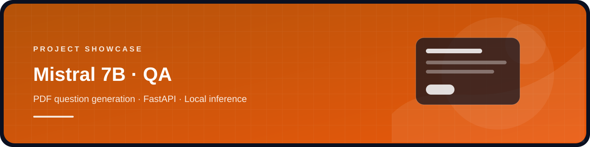

<div align="center">
  
  <h1>Question Answer Generation — Mistral 7B</h1>
  <p> </p>
  <p>A local PDF question-answer generation app using a Mistral 7B model through CTransformers and a FastAPI interface.</p>
</div>

## Features

- Accepts a PDF upload through a browser interface.
- Splits document text into chunks for question and answer generation.
- Runs a local GGUF model rather than shipping model weights in the source repository.

## Setup

Use a compatible Python environment, install the dependencies, and obtain the model weights separately:

```bash
python -m venv .venv
# Activate the environment, then:
pip install -r requirements.txt
```

Place the compatible `mistral-7b-instruct-v0.1.Q4_K_S.gguf` model file in the repository root, then start the server:

```bash
uvicorn app:app --reload
```

Open `http://127.0.0.1:8000`. The model file is not included: the local copy is about 3.9 GB, above GitHub's regular file-size limit. Follow the model publisher's license and distribution terms when obtaining weights.

## Repository contents

- `app.py` — FastAPI endpoints and document processing.
- `templates/index.html` — upload and results page.
- `requirements.txt` — Python dependencies restored from the original project history, plus Uvicorn for the server command.
- `LICENSE` — MIT license retained from the original AI Anytime source repository.

The source is adapted from [AIAnytime's original project](https://github.com/AIAnytime/Question-Answer-Generation-App-using-Mistral-7B); its MIT license is included. The original model weights, student reference PDFs, temporary runner file and generated CSV output are not included.
